<p align="center">
  
</p>

<p align="center">
  <a href="https://linkedin.com/in/ayoub-badr"></a>
  <a href="mailto:ayoub.badr82@gmail.com"></a>
  
  
</p>

---

### ▸ The panel above is the whole pitch

Most engineers can work at one level of that diagram. I built all five — on the same bench, wired end to end: a sensor at `L0`, a PLC program at `L1`, an operator panel at `L2`, an OPC UA gateway at `L3`, and a dashboard that actually tells you something at `L4`.

Third-year student at **ENSAM Meknès**, Electromechanical Engineering & Industrial Digitalization. I like the layer where the mechanical world stops being tidy and the data starts — the sensor that drifts, the bus that drops a frame, the alarm nobody acknowledged.

---

### ▸ What's wired in

**`L0` Field** — PT100 · Hall-effect current sensing · incremental encoders · IMU · custom acquisition PCBs · electrical schematics · power-chain sizing

**`L1` Control** — Siemens S7-1200 (TIA Portal) · Schneider TSX (PL7) · LADDER · GRAFCET · ESP32 · PID · LQR state feedback

**`L2` Supervision** — WinCC Advanced on KTP700 · SCADA · fault handling and acknowledgment · commissioning

**`L3` Integration** — AS-i · PROFIBUS DP · PROFINET · Modbus RTU/TCP · OPC UA (KEPServerEX, Prosys) · MQTT · Node-RED · ISA-95 · MES/ERP interfacing

**`L4` Data** — InfluxDB · SQLite · PostgreSQL · MongoDB · Grafana · threshold alerting · statistical drift analysis · Python

**Upstream** — CATIA V5 · SolidWorks · ANSYS Fluent · strength of materials · DXF for cutting

---

### ▸ Commissioned

**🎙️ Contactless Machine Control Station — voice, gesture, gaze**<br>
An operator station you drive without touching anything. I built the offline voice chain (Vosk, closed grammar), the operative part (ESP32, H-bridge, PID on encoder feedback) and the Node-RED supervision, over a versioned JSON-schema MQTT contract validated in CI. Safety first: emergency stop hardwired *outside* the software, 500 ms watchdog, two different modalities required to confirm a critical command. First real trial produced ~20 unintended gaze validations per minute — which is exactly why the design changed. Now extended into a research study comparing rule-based and learned sensor fusion.

**🏭 Variable Speed Drive Bench — three buses, one gateway**<br>
AS-i for the sensors, PROFIBUS DP and PROFINET between the devices, all converging on an S7-1200, then out through an OPC UA gateway to MES/ERP. WinCC HMI on the panel, Node-RED dashboard archiving to SQLite and InfluxDB, threshold alerts and drift analysis on top.

**🛗 5-Floor Elevator — from GRAFCET to the cloud**<br>
Functional analysis, full control program on a Schneider TSX with safety interlocks, then the entire chain stacked above it: Modbus RTU master/slave → Modbus TCP → MQTT to cloud → OPC UA normalization → real-time Node-RED supervision.

**📡 Connected Test Bench — instrumented and encrypted**<br>
Complete power chain sized (motor, PWM drive, protections, cable cross-sections), electrical schematics and a custom acquisition PCB — Hall-effect current, voltage, incremental encoder, PT100 — streaming over an encrypted and authenticated wireless link.

**🏥 3-Axis Automated Medical Bed — ABBE Technologie**<br>
A machine taken from blank page to moving prototype: mechanical design in CATIA V5 with strength-of-materials verification, DXF for cutting, actuator selection and sizing on three axes, the power electronics behind them, then the automated control and its touchscreen HMI, through to commissioning.

**🤖 Self-Balancing Robot — LQR**<br>
Inverted pendulum, modeled in state space, stabilized by an LQR controller on ESP32 with an MPU6050. Mechanical design, control study and software, all mine.

**🏗️ OCP Jorf Lasfar — sulfuric acid line (DCDA)**<br>
A month following a real production line through its SCADA: control loops, line instrumentation, critical parameters — and turning production data into a digitalized material balance.

---

### ▸ Currently in development

```
[████████░░] Multimodal fusion — rule-based vs. learned, leave-one-person-out evaluation
[█████░░░░░] Industrial cybersecurity — IT/DMZ/OT segmentation, Purdue model, IEC 62443
[███░░░░░░░] Fieldbus diagnostics and industrial remote access
[██░░░░░░░░] Publishing the acquisition and supervision chains to this account
```

---

<p align="center">
  <sub><strong>Looking for a 6-month final-year internship (PFE) from February 2027</strong> — automation, supervision, Industry 4.0 / IIoT.<br>
  <a href="mailto:ayoub.badr82@gmail.com">ayoub.badr82@gmail.com</a> · <a href="https://linkedin.com/in/ayoub-badr">linkedin.com/in/ayoub-badr</a></sub>
</p>
